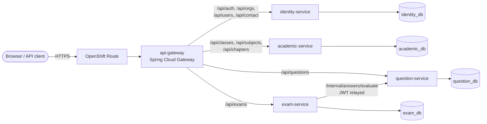

# M2ITS Online Exam Platform: Spring Boot microservices on ROSA

The legacy **m2its** online-exam MySQL database (`m2itssql_complete.sql`), rebuilt as production-ready
Spring Boot microservices with JPA/Hibernate, packaged as containers and deployed to
**Red Hat OpenShift Service on AWS (ROSA)**.

| | |
|---|---|
| Language / build | Java 17, Maven (wrapper included: no Maven install needed) |
| Framework | Spring Boot 4.0.8, Spring Cloud 2025.1.3 (Gateway), Spring Security (JWT), Spring Data JPA / Hibernate 7 |
| Database | MySQL 8.4 (in-cluster for dev, Amazon RDS for prod), Flyway migrations, H2 for local runs/tests |
| Containers | UBI 9 OpenJDK 17 images, layered jars; Dockerfile, Jib or OpenShift BuildConfig |
| Platform | ROSA (OpenShift 4) with Kustomize overlays, Routes, NetworkPolicies, HPA, PDB, ServiceMonitor |
| CI/CD | GitHub Actions (test → image → approved deploy) or GitOps with Argo CD |

## Architecture



| Service | Owns legacy tables | Port (local) |
|---|---|---|
| `identity-service` | `org_info`, `user_info`, `admin_info`, `contact_m2i` | 8081 |
| `academic-service` | `class_info`, `subject_info`, `chapter_info` | 8082 |
| `question-service` | `question_info_v_two`, `answer_info_v_two` | 8083 |
| `exam-service` | `exam_info` | 8084 |
| `api-gateway` | (none; routing only) | 8080 |

More detail in [docs/01-architecture.md](docs/01-architecture.md).

## Quick start

**Local (Java 17 only, no database or Docker needed):**

```powershell
.\mvnw.cmd install                    # build + 32 tests, installs common-lib locally
.\mvnw.cmd -pl identity-service spring-boot:run   # repeat per service, see docs/02
```

**On ROSA (dev environment, images built inside the cluster):**

```powershell
oc new-project m2its-dev
.\scripts\new-dev-secrets.ps1
oc apply -f deploy/openshift/builds.yaml
oc apply -k deploy/k8s/overlays/dev
foreach ($s in "identity-service","academic-service","question-service","exam-service","api-gateway") {
  oc start-build $s --from-repo=. }
$gw = oc get route api-gateway -o jsonpath='{.spec.host}'
.\scripts\verify-deployment.ps1 -BaseUrl "https://$gw" -Namespace m2its-dev
```

Demo logins (dev only): `superadmin@m2its.local`, `admin@demo.local`, `author@demo.local`, and
`student@demo.local`, all with password `Demo@123`.

## Guides

| # | Guide | What you learn |
|---|---|---|
| 1 | [Architecture](docs/01-architecture.md) | Service boundaries from the SQL schema, data ownership, security model, ORM techniques used |
| 2 | [Local development](docs/02-local-development.md) | Build, run, test and call the APIs on your PC |
| 3 | [Docker & images](docs/03-docker.md) | Dockerfile, layered jars, OpenShift-compatible images, Jib, Podman, compose |
| 4 | [Kubernetes & OpenShift](docs/04-kubernetes.md) | Every manifest explained: probes, resources, NetworkPolicy, HPA, PDB, Kustomize |
| 5 | [ROSA on AWS](docs/05-rosa-aws.md) | Create the cluster, deploy dev and prod (RDS), costs, clean-up |
| 6 | [DevOps & CI/CD](docs/06-devops-cicd.md) | Pipeline, image promotion, GitOps, secrets, observability, rollback |
| 7 | [Verify the deployment](docs/07-verify-deployment.md) | Checklist, smoke-test script, troubleshooting |
| 8 | [Legacy data migration](docs/08-legacy-data-migration.md) | Load the existing dump into the new databases safely |

## Repository layout

```
pom.xml                    parent POM (versions, Jib profile, test setup)
common-lib/                shared JWT security, tenant checks, errors, JPA helpers
identity-service/ ...      one Maven module per microservice
api-gateway/
Dockerfile                 one multi-stage Dockerfile for all services (--build-arg SERVICE=...)
docker-compose.yml         full stack + MySQL in local containers
deploy/
  k8s/base/                Deployments, Services, Route, ConfigMap, NetworkPolicies
  k8s/components/          optional pieces: in-cluster MySQL, Prometheus ServiceMonitor
  k8s/overlays/dev|prod/   environment-specific settings
  openshift/builds.yaml    ImageStreams + BuildConfigs (in-cluster image builds)
  argocd/                  GitOps Application for prod
  db/                      DB bootstrap and legacy import SQL
scripts/                   verify-deployment (.ps1/.sh), new-dev-secrets.ps1
.github/workflows/         CI/CD pipeline
```

> **Security note:** `m2itssql_complete.sql` contains real e-mail addresses and plain-text passwords.
> It is git-ignored and excluded from images. Never commit it (see [docs/08](docs/08-legacy-data-migration.md)).
