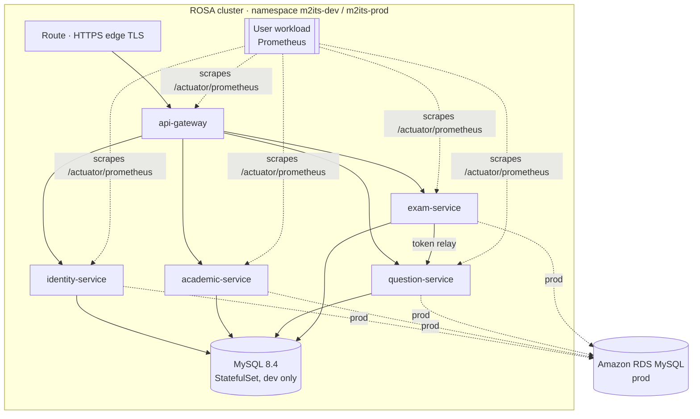
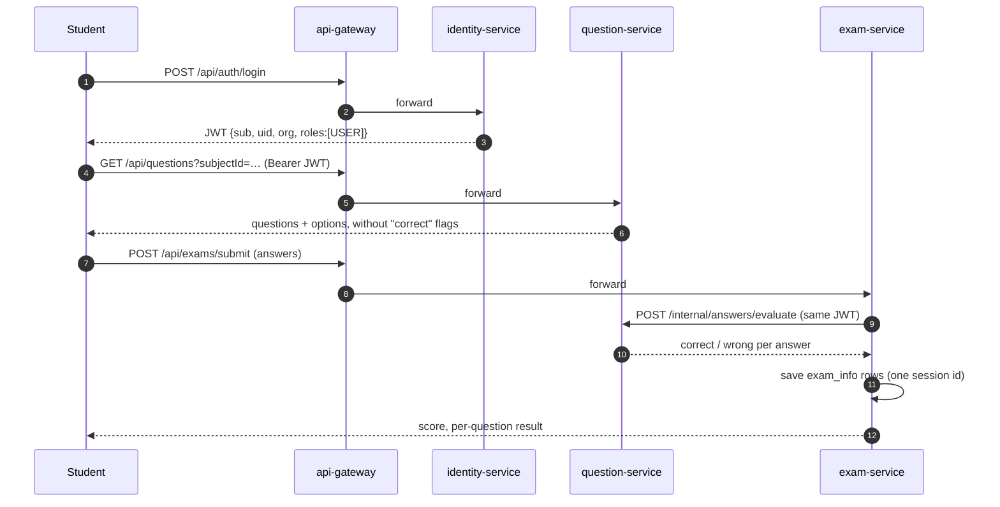

# 1. Architecture

## 1.1 From one database to four services

The legacy dump is a single MySQL schema (`m2its`, 16 tables) used by a PHP application. Microservices
are split along **business capabilities** and **who changes the data together**:

| Legacy table | Rows | Decision | Owner service |
|---|---|---|---|
| `org_info` | 20 | tenant (school/institute) | identity-service |
| `user_info` | 43 | org members: Admin / Data Entry Operator / User | identity-service |
| `admin_info` | 5 | platform super admins | identity-service |
| `contact_m2i` | 3 | public "contact us" form | identity-service |
| `class_info` | 25 | class / grade | academic-service |
| `subject_info` | 24 | subject of a class | academic-service |
| `chapter_info` | 3 | chapter of a subject | academic-service |
| `question_info_v_two` | 1023 | question bank (current version) | question-service |
| `answer_info_v_two` | 3909 | answer options of a question | question-service |
| `exam_info` | 413 | one row per answered question of an exam sitting | exam-service |
| `question_info` | | v1 questions, superseded by `_v_two` | **not migrated** |
| `answer_info_v_two_bk` | | backup copy | **not migrated** |
| `main_table`, `dynamic_table`, `test_table_one` | | test tables | **not migrated** |
| `role_master` | 0 | empty, roles are hard-coded strings | **not migrated** |

**Table and column names are kept unchanged.** JPA entities map the legacy names, so existing data can be
copied over with plain `INSERT ... SELECT` ([docs/08](08-legacy-data-migration.md)), and old reports keep working.

### Database per service

Each service has its **own database and DB user** (`identity_db`, `academic_db`, `question_db`, `exam_db`).
A service never reads another service's tables; it calls that service's API instead. Consequences:

- Foreign keys that crossed service boundaries were **removed** (for example `question_info_v_two.fk_class_id → class_info`).
  The ids are still stored, and the application checks them.
- Foreign keys **inside** a service stay (`subject_info → class_info`, `answer_info_v_two → question_info_v_two`).
- One MySQL server can host all four databases (cheaper). Splitting them across servers later needs no code change.

## 1.2 Components

| Module | Responsibility | Notable techniques |
|---|---|---|
| [common-lib](../common-lib) | Shared code for servlet services | Spring Boot auto-configuration, JWT resource server, RFC 9457 problem responses, `Persistable` base entity, time-ordered ids |
| [identity-service](../identity-service) | Orgs, users, super admins, login (issues JWT), contact form | Legacy plain-text → BCrypt upgrade on login, timing-safe login |
| [academic-service](../academic-service) | Classes → subjects → chapters | `@ManyToOne(LAZY)`, derived queries on nested properties, `JOIN FETCH` tree query |
| [question-service](../question-service) | Questions + answer options, scoring API | Aggregate root with cascade, `AttributeConverter` (Yes/No ↔ boolean), soft-delete of options, batch fetching |
| [exam-service](../exam-service) | Submit exams, results, history | `RestClient` with timeouts + `@Retryable`, JPQL constructor expression with `GROUP BY`, custom metric |
| [api-gateway](../api-gateway) | Single public entry point | Spring Cloud Gateway (WebFlux), CORS, no route for `/internal/**` |

Package layout: identity-service is split by feature (`auth`, `org`, `user`, `contact`) because its four
features are unrelated. The other services use `domain` / `service` / `api` layers around one aggregate.

## 1.3 Request flow: a student submits an exam

The remote call (step 8) runs **before** the database transaction starts, so a slow question-service
never holds a DB connection in exam-service.

## 1.4 Security model

- **Authentication:** `POST /api/auth/login` checks `admin_info` and then `user_info`, and returns an
  **HS256 JWT** valid for 1 hour. Claims: `sub` (email), `uid`, `org`, `name`, `roles`.
- **Every service validates the token itself** (signature, expiry, issuer), configured once in
  [JwtSecurityAutoConfiguration](../common-lib/src/main/java/com/m2its/common/security/JwtSecurityAutoConfiguration.java).
  The gateway is not trusted blindly (zero trust).
- **Multi-tenancy:** [AuthenticatedUser](../common-lib/src/main/java/com/m2its/common/security/AuthenticatedUser.java)
  pins ADMIN / DATA_ENTRY / USER callers to the organisation in their token. Only SUPERADMIN may pass
  `orgId` to work across organisations.
- **Passwords:** stored as `{bcrypt}…`. Legacy plain-text values are tagged `{noop}` during migration and
  re-hashed on the next successful login.

| Capability | SUPERADMIN | ADMIN | DATA_ENTRY | USER |
|---|:-:|:-:|:-:|:-:|
| Manage organisations | ✔ | | | |
| Manage users of own org | ✔ | ✔ | | |
| Edit classes, subjects, chapters, questions | ✔ | ✔ | ✔ | |
| See correct answers in the question bank | ✔ | ✔ | ✔ | |
| Read catalogue and questions, take exams | ✔ | ✔ | ✔ | ✔ |
| See all exam results of the org | ✔ | ✔ | | own only |

`/internal/**` endpoints reveal answers. They are not routed by the gateway, NetworkPolicies limit
who can reach question-service, and they still require a JWT.

## 1.5 ORM (JPA / Hibernate) techniques, with where to find them

| Technique | Where | Why |
|---|---|---|
| Flyway owns the schema, Hibernate `ddl-auto: validate` | `src/main/resources/db/migration`, `application.yml` | Versioned, reviewable schema changes; app refuses to start if entities and tables disagree |
| Mapping legacy names with `@Table` / `@Column` | all entities | Keep the existing schema and data |
| `AttributeConverter` | [RecordStatusConverter](../common-lib/src/main/java/com/m2its/common/jpa/RecordStatusConverter.java), [YesNoConverter](../question-service/src/main/java/com/m2its/question/domain/YesNoConverter.java), [OrgRole.DbConverter](../identity-service/src/main/java/com/m2its/identity/user/OrgRole.java) | Type-safe enums/booleans over legacy strings (`'A'`, `'Yes'`, `'Admin'`) |
| Assigned String ids + `Persistable` | [AssignedIdEntity](../common-lib/src/main/java/com/m2its/common/jpa/AssignedIdEntity.java) | `save()` does an INSERT, not SELECT + INSERT |
| Time-ordered ids | [Ids](../common-lib/src/main/java/com/m2its/common/jpa/Ids.java) | Sequential B-tree inserts; `ORDER BY id` = creation order |
| `@ManyToOne(fetch = LAZY)` | [Subject](../academic-service/src/main/java/com/m2its/academic/domain/Subject.java), [Chapter](../academic-service/src/main/java/com/m2its/academic/domain/Chapter.java) | Load parents only when needed |
| Bidirectional `@OneToMany(mappedBy, cascade = ALL)` | [Question](../question-service/src/main/java/com/m2its/question/domain/Question.java) | Save a question and its options together (aggregate) |
| `JOIN FETCH` | [ChapterRepository](../academic-service/src/main/java/com/m2its/academic/domain/ChapterRepository.java), [QuestionRepository](../question-service/src/main/java/com/m2its/question/domain/QuestionRepository.java) | Avoid N+1 queries |
| `hibernate.default_batch_fetch_size` | `application.yml` | Pages of questions load all options in one extra query |
| Derived queries, `@Query` JPQL, paging | repositories | Readable queries without SQL strings |
| JPQL constructor expression + `GROUP BY` + `countQuery` | [ExamAnswerRepository](../exam-service/src/main/java/com/m2its/exam/domain/ExamAnswerRepository.java) | Read models straight from the DB |
| Dirty checking (no explicit `save` on update) | `update…` service methods | Managed entities are flushed on commit |
| `@UpdateTimestamp` / `@CreationTimestamp` | entities | Audit columns filled automatically |
| Soft delete via status | services | Exam history keeps pointing at valid rows |
| `open-in-view: false`, read-only transactions | `application.yml`, `@Transactional(readOnly = true)` | No lazy loading in controllers; cheaper reads |

## 1.6 Legacy data quality found and handled

| Finding | Handling |
|---|---|
| Plain-text passwords | `{noop}` tagging + BCrypt upgrade on login |
| Duplicate user emails (same person, several rows) | Login tries every active match, newest first; new users must have unique emails |
| Third role `Data Entry Operator` (4 users) | Mapped to role `DATA_ENTRY` |
| Status codes `A`, `I`, `D`, `C`, **`DEL`** | All mapped in `RecordStatus`; only `A` counts as active |
| `answer_info_v_two.fk_chapter_id` is often empty | Kept as is |
| `chapter_info` had no FK to `subject_info` | FK added; import skips orphans |

## 1.7 Trade-offs and next steps

| Today (simple, good for learning) | Production evolution |
|---|---|
| Shared HS256 secret | RS256 with a JWKS endpoint, or Red Hat build of Keycloak as identity provider |
| Synchronous REST between exam and question | Add events (Kafka / AMQ Streams) with an outbox table when more consumers appear |
| Scores computed on read | Store a score snapshot per session if questions change often |
| No rate limiting | Gateway `RequestRateLimiter` with Redis to protect `/api/auth/login` |
| One MySQL server, four schemas | Separate RDS instances per service if load or blast radius requires |
