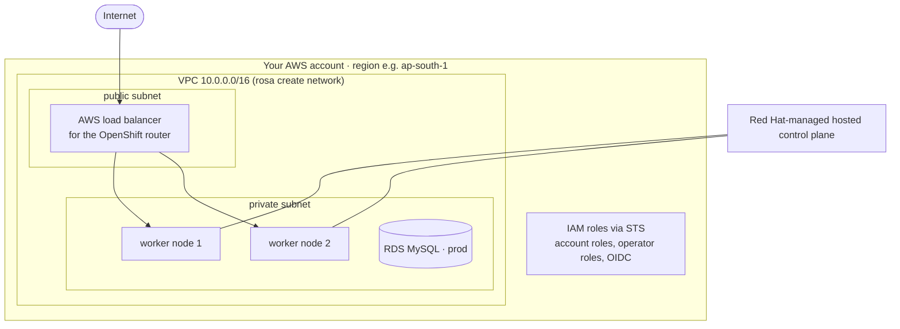

# 5. Deploying to ROSA (Red Hat OpenShift Service on AWS)

ROSA is OpenShift run by Red Hat and AWS in **your** AWS account. This guide uses **ROSA with hosted
control planes (HCP)**, the current default: the control plane runs in a Red Hat-managed account, and you
pay for and see only the worker nodes. Cluster creation takes about 15 minutes.

> **Cost warning.** The smallest cluster (2 × m7i.xlarge workers + ROSA fees) costs very roughly
> **USD 1 per hour, about USD 25 per day**, plus RDS if you create it. Check the
> [ROSA pricing page](https://aws.amazon.com/rosa/pricing/) for your region, and **delete the cluster when you
> stop learning for the day** ([section 5.8](#58-clean-up-stop-paying)).

## 5.1 What gets built



## 5.2 One-time preparation

**Accounts**

1. AWS account with admin rights for the setup (an IAM user or IAM Identity Center/SSO).
2. Free Red Hat account: https://console.redhat.com
3. In the AWS console open **Red Hat OpenShift Service on AWS → Get started**: enable ROSA, link your Red Hat
   account and let it create the ELB service-linked role.

**CLI tools on Windows** (PowerShell)

```powershell
winget install -e --id Amazon.AWSCLI               # AWS CLI v2
# ROSA CLI (>= 1.2.48): download, unzip, put rosa.exe on your PATH
Invoke-WebRequest https://mirror.openshift.com/pub/openshift-v4/clients/rosa/latest/rosa-windows.zip -OutFile rosa.zip
Expand-Archive rosa.zip -DestinationPath $HOME\bin -Force
# OpenShift CLI (oc) via rosa, or from https://mirror.openshift.com/pub/openshift-v4/clients/ocp/stable/
rosa download openshift-client
# add $HOME\bin to PATH (System settings → Environment variables) and open a new terminal
aws --version; rosa version; oc version --client
```

**Log in and check the account**

```powershell
aws configure                       # access key / SSO, default region e.g. ap-south-1
rosa login --use-auth-code          # opens the browser to log in to your Red Hat account
rosa whoami
rosa list regions --hosted-cp       # pick a region that supports HCP
rosa verify quota --region ap-south-1
```

## 5.3 Create the cluster

```powershell
$REGION  = "ap-south-1"
$CLUSTER = "m2its"
$ACCOUNT = aws sts get-caller-identity --query Account --output text

# 1) Account-wide IAM roles (once per AWS account)
rosa create account-roles --hosted-cp --mode auto --yes

# 2) Network: a VPC with public + private subnets, created through CloudFormation
rosa create network --param Region=$REGION --param Name=m2its-vpc --param AvailabilityZoneCount=1 --param VpcCidr=10.0.0.0/16
#    note the subnet ids printed at the end, comma separated:
$SUBNETS = "subnet-0aaa...,subnet-0bbb..."

# 3) OIDC provider: lets cluster operators assume IAM roles (STS, no static keys)
rosa create oidc-config --mode auto --yes
$OIDC_ID = "<id printed by the previous command>"     # also: rosa list oidc-config

# 4) Operator roles for this cluster
rosa create operator-roles --hosted-cp --prefix $CLUSTER --oidc-config-id $OIDC_ID `
  --installer-role-arn "arn:aws:iam::${ACCOUNT}:role/ManagedOpenShift-HCP-ROSA-Installer-Role" --mode auto --yes

# 5) The cluster (2 workers, default instance type m7i.xlarge)
rosa create cluster --cluster-name $CLUSTER --hosted-cp --sts --mode auto --region $REGION `
  --oidc-config-id $OIDC_ID --operator-roles-prefix $CLUSTER --subnet-ids $SUBNETS --replicas 2 --yes

rosa logs install --cluster $CLUSTER --watch           # about 15 minutes
rosa describe cluster --cluster $CLUSTER               # State: ready
```

**Log in with oc**

```powershell
rosa create admin --cluster $CLUSTER
# prints: oc login https://api.m2its.xxxx.openshiftapps.com:443 --username cluster-admin --password ...
# (wait 1-2 minutes for the user to become active, then run the printed command)
oc whoami; oc get nodes
rosa describe cluster --cluster $CLUSTER | Select-String Console   # web console URL
```

> For a team or production, replace `cluster-admin` with a real identity provider
> (`rosa create idp --type github|google|openid ...`) and grant roles per person.

## 5.4 Deploy the DEV environment

Dev uses an in-cluster MySQL with demo data, and builds the images **inside the cluster**, so your PC
needs no Docker.

```powershell
cd D:\andrew\git\ocprosadeployment
git add -A; git commit -m "M2ITS microservices"     # --from-repo uploads the last commit

oc new-project m2its-dev
.\scripts\new-dev-secrets.ps1                         # random passwords → deploy/k8s/overlays/dev/secrets/*.env

oc apply -f deploy/openshift/builds.yaml               # ImageStreams + BuildConfigs
oc apply -k deploy/k8s/overlays/dev                    # MySQL, ConfigMap, Secrets, Deployments, Route, policies

# build all five images (in parallel, ~5 min). Pods start automatically when their image is ready.
foreach ($s in "identity-service","academic-service","question-service","exam-service","api-gateway") {
  oc start-build $s --from-repo=. }
oc get builds -w                                       # Ctrl+C when all are Complete
oc logs -f bc/identity-service                         # build log of one service

oc get pods                                            # all Running and READY 1/1
oc get route api-gateway                               # the public URL
```

Then verify: [07-verify-deployment.md](07-verify-deployment.md).

```powershell
$gw = oc get route api-gateway -o jsonpath='{.spec.host}'
.\scripts\verify-deployment.ps1 -BaseUrl "https://$gw" -Namespace m2its-dev
```

**Redeploy after a code change:** commit, then `oc start-build <service> --from-repo=.`. The image trigger
rolls the Deployment automatically.

## 5.5 Deploy the PROD environment (Amazon RDS)

### a) Create the RDS database in the cluster's VPC

```powershell
$VPC = aws ec2 describe-subnets --subnet-ids ($SUBNETS -split ",")[0] --query "Subnets[0].VpcId" --output text
$PRIVATE = "subnet-0bbb..."     # the private subnet(s) from rosa create network
                                # (RDS needs subnets in >= 2 AZs: use AvailabilityZoneCount=3 for prod networks)

aws rds create-db-subnet-group --db-subnet-group-name m2its-db --db-subnet-group-description "m2its" `
  --subnet-ids ($PRIVATE -split ",")
$SG = aws ec2 create-security-group --group-name m2its-db --description "MySQL from ROSA" --vpc-id $VPC --query GroupId --output text
aws ec2 authorize-security-group-ingress --group-id $SG --protocol tcp --port 3306 --cidr 10.0.0.0/16

aws rds create-db-instance --db-instance-identifier m2its-mysql --engine mysql --engine-version 8.4 `
  --db-instance-class db.t4g.micro --allocated-storage 20 --storage-encrypted `
  --master-username dbadmin --manage-master-user-password `
  --db-subnet-group-name m2its-db --vpc-security-group-ids $SG --no-publicly-accessible `
  --backup-retention-period 7
aws rds wait db-instance-available --db-instance-identifier m2its-mysql
aws rds describe-db-instances --db-instance-identifier m2its-mysql --query "DBInstances[0].Endpoint.Address" --output text
```

`--manage-master-user-password` stores the admin password in **AWS Secrets Manager** (view it there).
Use `--multi-az` for real production.

### b) Create the four databases and users

```powershell
oc new-project m2its-prod
oc run mysql-client --image=registry.redhat.io/rhel9/mysql-84 --restart=Never --command -- sleep 3600
# copy deploy/db/init-databases.sql to a local prod-init.sql, replace the four *-dev-pw passwords
# with strong ones, then:
Get-Content prod-init.sql | oc exec -i mysql-client -- mysql -h <rds-endpoint> -u dbadmin -p'<admin-password>'
oc delete pod mysql-client
Remove-Item prod-init.sql
```

### c) Secrets, images, configuration

```powershell
oc create secret generic m2its-jwt   --from-literal=JWT_SECRET=<48+ random chars>
oc create secret generic identity-db --from-literal=DB_USERNAME=identity --from-literal=DB_PASSWORD=<pw>
oc create secret generic academic-db --from-literal=DB_USERNAME=academic --from-literal=DB_PASSWORD=<pw>
oc create secret generic question-db --from-literal=DB_USERNAME=question --from-literal=DB_PASSWORD=<pw>
oc create secret generic exam-db     --from-literal=DB_USERNAME=exam     --from-literal=DB_PASSWORD=<pw>
```

In [overlays/prod/kustomization.yaml](../deploy/k8s/overlays/prod/kustomization.yaml):

- set `DB_HOST` to the RDS endpoint and `CORS_ALLOWED_ORIGINS` to your front-end URL;
- set `images:` to where your prod images are. Either:
  - **CI-built images** in Quay/ECR (the pipeline in [06](06-devops-cicd.md) does this), or
  - **promote the tested dev images** inside the cluster (OpenShift-native promotion):

    ```powershell
    oc policy add-role-to-user system:image-puller system:serviceaccount:m2its-prod:default -n m2its-dev
    oc tag m2its-dev/identity-service:latest m2its-dev/identity-service:1.0.0   # repeat per service
    # and use newName: image-registry.openshift-image-registry.svc:5000/m2its-dev/<service>, newTag: "1.0.0"
    ```

```powershell
oc apply -k deploy/k8s/overlays/prod
oc get pods -n m2its-prod
```

Prod has no demo data, so check health instead of running the full smoke test:
`curl https://<prod-route>/actuator/health/readiness`. Load real data with [08](08-legacy-data-migration.md).

## 5.6 Production hardening checklist

| Area | Do |
|---|---|
| Identity | IdP instead of `cluster-admin`; least-privilege RoleBindings per namespace |
| Secrets | External Secrets Operator + AWS Secrets Manager (see [06](06-devops-cicd.md#64-secrets-management)) |
| Network | Private cluster (`--private`) or restrict the router with allow-lists; AWS WAF in front if public |
| Custom domain | `exam.your-domain.com` → Route with your certificate (`oc create route edge --cert ... --hostname ...`), or cert-manager Operator |
| Availability | 3 AZs (`AvailabilityZoneCount=3`), `--multi-az` RDS, 2+ replicas (prod overlay), machine pool autoscaling (`rosa edit machinepool --enable-autoscaling`) |
| Data | RDS automated backups + snapshots before migrations; test restores |
| Upgrades | `rosa upgrade cluster` / schedule upgrade policies; PDBs keep the app up during node drains |
| Logs | ROSA log forwarding to Amazon CloudWatch |
| Cost | Turn off dev clusters when unused; right-size requests from `oc adm top pods` |

## 5.7 Useful ROSA commands

| Task | Command |
|---|---|
| List clusters | `rosa list clusters` |
| Cluster details / console URL | `rosa describe cluster -c m2its` |
| Add worker capacity | `rosa edit machinepool -c m2its workers --replicas 3` (see `rosa list machinepools -c m2its`) |
| Autoscale workers | `rosa edit machinepool -c m2its workers --enable-autoscaling --min-replicas 2 --max-replicas 4` |
| Available upgrades | `rosa list upgrades -c m2its` |

## 5.8 Clean up (stop paying)

```powershell
oc delete project m2its-dev m2its-prod
aws rds delete-db-instance --db-instance-identifier m2its-mysql --skip-final-snapshot   # if created
rosa delete cluster --cluster m2its --yes
rosa logs uninstall --cluster m2its --watch
rosa delete operator-roles --prefix m2its --mode auto --yes
rosa delete oidc-config --oidc-config-id $OIDC_ID --mode auto --yes
aws cloudformation delete-stack --stack-name m2its-vpc      # the VPC from rosa create network
# account roles cost nothing and can stay for next time
```

Persistent volumes (the dev MySQL EBS volume) are deleted with the project/cluster.

## References

- [Create a ROSA with HCP cluster quickly (Red Hat docs)](https://docs.redhat.com/en/documentation/red_hat_openshift_service_on_aws/4/html/install_clusters/rosa-hcp-sts-creating-a-cluster-quickly)
- [`rosa create network` (Red Hat knowledge article)](https://access.redhat.com/articles/7096266)
- [ROSA pricing](https://aws.amazon.com/rosa/pricing/)
