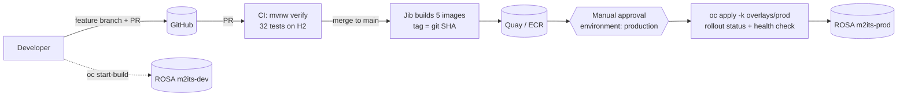

# 6. DevOps and CI/CD

## 6.1 The delivery flow



| Stage | Tool | File |
|---|---|---|
| Source control | Git + GitHub, trunk-based (short-lived branches, PRs into `main`) | |
| Build & test | Maven Wrapper, JUnit 5, MockMvc, H2 | [pom.xml](../pom.xml) |
| Package | Jib (CI) / Dockerfile (in-cluster builds) | [pom.xml](../pom.xml), [Dockerfile](../Dockerfile) |
| Pipeline | GitHub Actions | [.github/workflows/ci-cd.yml](../.github/workflows/ci-cd.yml) |
| Deploy | Kustomize + `oc`, or Argo CD (GitOps) | [deploy/k8s](../deploy/k8s), [deploy/argocd](../deploy/argocd/m2its-prod-application.yaml) |
| Verify | smoke-test scripts, probes, metrics | [scripts](../scripts) |

## 6.2 The GitHub Actions pipeline

[ci-cd.yml](../.github/workflows/ci-cd.yml) has three jobs:

1. **build-test** (every push and PR): `./mvnw -B verify`. Test reports are uploaded when it fails.
2. **images** (only `main`): a matrix job builds the 5 images in parallel with Jib and pushes
   `quay.io/<org>/<service>:<git-sha>`. No Docker daemon is needed on the runner.
3. **deploy-prod**: runs in the GitHub **environment `production`**, so a reviewer must approve. It pins
   the image tags in the prod overlay with `yq`, runs `oc apply -k`, waits for every rollout, then calls the
   readiness endpoint through the public Route. A failed rollout fails the pipeline.

**Setup:**

1. Create a Quay.io organisation and a **robot account** with write access → `REGISTRY_USERNAME`,
   `REGISTRY_PASSWORD`; repository variable `IMAGE_REGISTRY=quay.io/<org>`. Make the repos public, or add a
   pull secret to `m2its-prod` (`oc create secret docker-registry quay --docker-server=quay.io ...` then
   `oc secrets link default quay --for=pull`).
2. Create a deployer ServiceAccount on the cluster and give its token to GitHub:

   ```powershell
   oc create serviceaccount deployer -n m2its-prod
   oc policy add-role-to-user edit -z deployer -n m2its-prod
   oc create token deployer -n m2its-prod --duration=8760h     # → secret OPENSHIFT_TOKEN
   oc whoami --show-server                                       # → variable OPENSHIFT_SERVER
   ```
3. GitHub → Settings → Environments → `production` → required reviewers.

## 6.3 Image tagging and promotion

- **Never deploy `latest` to prod.** Tag with the git SHA: every running pod maps to an exact commit, and
  rolling back means redeploying an older tag.
- **Build once, promote the same image** (dev → prod), never rebuild per environment. In-cluster
  alternative: `oc tag m2its-dev/exam-service@sha256:... m2its-prod/exam-service:1.4.0`.
- Optionally add semantic versions on release (`1.4.0`) in addition to the SHA.

## 6.4 Secrets management

| Level | How | When |
|---|---|---|
| Basic | `oc create secret generic ...` by an admin | learning, small teams |
| Dev convenience | Kustomize `secretGenerator` from git-ignored `.env` files | this repo's dev overlay |
| **Recommended** | **External Secrets Operator** (OperatorHub) syncing from **AWS Secrets Manager**, authenticated with an IAM role for the ServiceAccount (STS) | production on ROSA |
| GitOps-friendly | Sealed Secrets (encrypted secrets in git) | when ESO is not an option |

Example `ExternalSecret` (after installing the operator and a `SecretStore` for Secrets Manager):

```yaml
apiVersion: external-secrets.io/v1
kind: ExternalSecret
metadata: { name: identity-db, namespace: m2its-prod }
spec:
  refreshInterval: 1h
  secretStoreRef: { kind: SecretStore, name: aws-secrets-manager }
  target: { name: identity-db }
  data:
    - secretKey: DB_USERNAME
      remoteRef: { key: m2its/prod/identity-db, property: username }
    - secretKey: DB_PASSWORD
      remoteRef: { key: m2its/prod/identity-db, property: password }
```

Rotate the JWT secret by deploying the new value and restarting all services together
(`oc rollout restart deployment -n m2its-prod`). Users then log in again.

## 6.5 GitOps with Argo CD (OpenShift GitOps)

Instead of the pipeline running `oc apply`, **git becomes the source of truth** and Argo CD keeps the
cluster equal to it:

1. Install the **Red Hat OpenShift GitOps** operator from OperatorHub.
2. Let it manage the namespace: `oc label namespace m2its-prod argocd.argoproj.io/managed-by=openshift-gitops`.
3. `oc apply -f deploy/argocd/m2its-prod-application.yaml` (edit `repoURL` first).
4. A release = a commit changing `newTag` in `overlays/prod/kustomization.yaml` (CI can open that PR).
   Rollback = `git revert`. Manual changes in the cluster are reverted automatically (`selfHeal`).

Change the pipeline's `deploy-prod` job to "commit new tag" when you adopt this.

**OpenShift Pipelines (Tekton)** is the in-cluster alternative to GitHub Actions: pipelines run as pods
on ROSA. It's useful when source code or registries must not leave your network.

## 6.6 Database changes in a pipeline

- Flyway runs at service start-up; the first new pod of a rollout migrates the schema.
- Rolling updates mean old and new versions run **at the same time**. Use **expand / contract**:
  1. release N adds the new column (nullable) and writes both;
  2. release N+1 reads the new column and backfills;
  3. release N+2 drops the old column.
- Never edit an applied migration (Flyway validates checksums and refuses to start); always add `V<n+1>__...`.
- Snapshot RDS before releases with migrations.

## 6.7 Observability

| Signal | Where | How |
|---|---|---|
| Metrics | OpenShift console → **Observe → Metrics** | Micrometer → `/actuator/prometheus` → user workload Prometheus ([ServiceMonitor](../deploy/k8s/components/monitoring/service-monitor.yaml)) |
| Business metric | `m2its_exams_submitted_total{org=...}` | custom counter in [ExamService](../exam-service/src/main/java/com/m2its/exam/service/ExamService.java) |
| HTTP metrics | `http_server_requests_seconds_*`, `http_client_requests_seconds_*` (exam → question) | auto by Spring Boot |
| Logs | `oc logs`, console → Workloads → Pod → Logs; prod in ECS JSON format, forward to CloudWatch | `LOGGING_STRUCTURED_FORMAT_CONSOLE=ecs` |
| Health | `/actuator/health/{liveness,readiness}` | probes |
| Alerts | `PrometheusRule` objects (e.g. 5xx rate > 1 % for 5 min) | add when going live |

Useful PromQL:

```
sum by (application) (rate(http_server_requests_seconds_count{namespace="m2its-prod",status=~"5.."}[5m]))
histogram_quantile(0.95, sum by (le, application) (rate(http_server_requests_seconds_bucket{namespace="m2its-prod"}[5m])))
```

Next step: distributed tracing with Micrometer Tracing + OpenTelemetry → Red Hat build of OpenTelemetry / Tempo.

## 6.8 Rollback playbook

| Situation | Action |
|---|---|
| New pods never become Ready | Nothing to do: `maxUnavailable: 0` keeps old pods serving. Fix and redeploy |
| Bad release is live | `oc rollout undo deployment/<service> -n m2its-prod` (or `git revert` with Argo CD) |
| Bad migration | Restore the RDS snapshot; deploy the previous tag |
| Bad config | Fix the ConfigMap/Secret, then `oc rollout restart deployment/<service>` |

## 6.9 Quality gates worth adding

- Static analysis / coverage (SonarQube or SonarCloud) on PRs
- Dependency vulnerability scan (OWASP dependency-check, GitHub Dependabot)
- Image scanning (Quay, Trivy) and policy enforcement (Red Hat Advanced Cluster Security)
- Contract tests between exam-service and question-service (Spring Cloud Contract)
- Track DORA metrics: deployment frequency, lead time, change failure rate, time to restore
